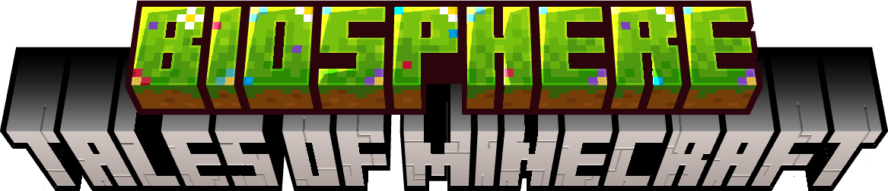

  

  <a href="docs/README.en.md">English</a> &nbsp;·&nbsp; <a href="docs/README.zh-CN.md">简体中文</a>

> [!WARNING]
> **早期开发阶段 / Early Development**
>
> 本项目仍处于非常早期的开发阶段。功能、数据格式、命令和 API 都可能发生重大变更，且不保证向后兼容。请勿用于生产环境或长期存档，升级前务必备份。
>
> This project is in a very early stage of development. Features, data formats, commands, and APIs may change significantly without backward compatibility. Not recommended for production or long-term worlds. Always back up before updating.
>
> **AI 辅助创作 / AI-Assisted**
>
> 本项目在开发过程中使用了 AI 辅助（deepseek-flash）。且并不是所有代码、文档与设计均经过人工审查与测试。
>
> This project was developed with assistance from AI (deepseek-flash). NOT all code, documentation, and design have been reviewed and tested by humans.

# TOMC-Biosphere

> 📘 **Data-driven guide** — [docs/data-driven.en.md](docs/data-driven.en.md)

**TOMC-Biosphere** is a data-driven ecology mod for **Fabric** on **Minecraft 1.21.11**. It breathes life into your world with three interlocking systems — **food-chain relationships**, **eating interactions** and **random-tick environmental succession** — all driven by plain JSON files that you can extend with a data pack, no Java code required.

## Features

### 🍖 Food-chain relationships

Mobs form a real food web. Predators hunt, prey flee — including passive mobs that normally never fight:

- **Chickens** hunt silverfish · **armadillos** hunt spiders · **ocelots** hunt creepers.
- **Dolphins** hunt squid · **polar bears** hunt fish.
- **Zombies** hunt livestock · **skeletons** hunt prey · **phantoms**, **shulkers** and **vexes** each gain prey.
- Prey flee their predators: allays flee vexes, livestock flee the undead, fish flee polar bears, villagers flee skeletons, creepers flee ocelots.

Passive mobs receive a new melee AI whose damage, chase speed and cooldown are all configurable.

### 🥕 Eating interactions

Animals eat the world around them, each with a sheep-style head-bob animation:

- **Cows** graze grass and eat mycelium, with a configurable chance to turn into a **mooshroom**.
- **Camels** pathfind to a cactus and eat it from the base.
- **Pigs** seek out ripe crops, melons and pumpkins.
- **Mooshrooms** nibble mushrooms and turn mycelium back into dirt.
- **Horses, donkeys and mules** graze like sheep.

### 🌱 Random-tick succession

Blocks evolve through random ticks — the same mechanic vanilla grass spreading uses:

- Flowers wither away, dropping their dye.
- Grass grows; dry grass succeeds into new plants; leaf litter turns grass into podzol.
- End stone sprouts chorus flowers under the open sky; chorus plants wither.
- Crimson/warped nylium spreads its vegetation; nether plants wither.
- Every rule can carry a **predicate** (`biomes`, `can_see_sky`, `block`, …) so changes happen only where you want.

### 🐚 Natural spawns

Extend where mobs spawn: **phantoms** haunt the End islands, **endermites** skitter across the End midlands and highlands.

### 🧊 Enderman block-carrying whitelist

Endermen normally only pick up the twenty-odd blocks hard-coded in the `minecraft:enderman_holdable` tag. This mod can rebuild that list out of **whole creative inventory tabs**:

- Choose any combination of the eleven content tabs; the whitelist becomes every block inside them.
- A hand-written **blacklist** tag (`biosphere:enderman_holdable_blacklist`) is subtracted afterwards and always wins — end stone, bedrock, obsidian, the portal frames, and every operator-tab block can never be carried.
- Multiblock structures (beds, doors, double plants) are filtered out, so an enderman never walks off with half a structure.
- Turning the override off restores the vanilla tag exactly.

## Design philosophy

Every behaviour above is a **JSON rule** under `data/biosphere/`. The mod ships sensible defaults and reads them from the data-pack resource manager, so you can add, tweak or remove any behaviour by dropping a file into a data pack — no code, no rebuild. The rule formats (succession, relationships, spawns) and the bundled tags are documented in the guide linked below.

## Requirements

- Minecraft **1.21.11**
- Fabric Loader **0.19.5+**
- [Fabric API](https://modrinth.com/mod/fabric-api)
- [Cloth Config](https://modrinth.com/mod/cloth-config) (configuration UI)
- [Mod Menu](https://modrinth.com/mod/modmenu) (optional — opens the config screen)

## Configuration

The server-authoritative config is edited in-game via **Mod Menu → TOMC-Biosphere**:

- **Modules** — toggle food-chain AI, environmental succession and the spawn data pack; set the cow→mooshroom conversion chance.
- **Passive Attack** — melee damage, chase speed, attack cooldown and flee speed.
- **Enderman** — override the vanilla block-carrying whitelist and pick which creative tabs it is built from.
- **Creefern** — compatibility toggles for the Creefern mod.

The config lives on the server and is sent to clients on join. The screen is editable only where the world is being run — singleplayer, or before joining anything; as a guest on someone else's server every entry is greyed out and read-only.

Changes to loaded data apply after the world is reloaded.

## License

[GPL-3.0](LICENSE)

---

> 📘 **Data-driven guide** — [docs/data-driven.en.md](docs/data-driven.en.md)
